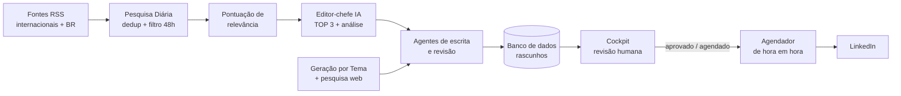
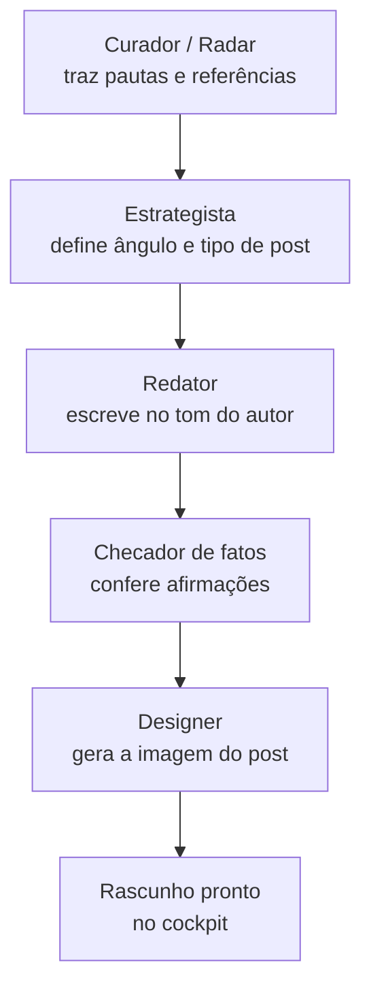
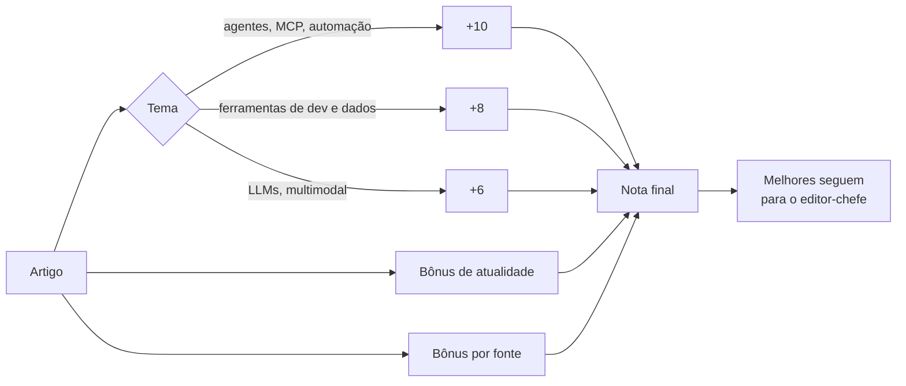
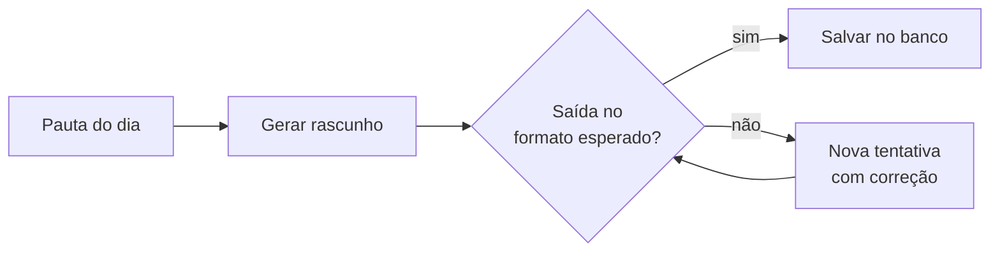
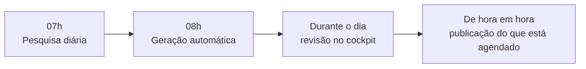

# Arquitetura visual

Este documento é o "desenho" do AI Post Studio: as etapas do pipeline, os agentes e o ciclo de um dia. Serve para entender o sistema sem ver uma linha de código.

Veja também o [README.md](README.md) (visão geral em texto).

## 1. Panorama geral

## 2. Os 5 agentes

Cada agente tem uma única responsabilidade. Isso deixa os prompts menores, mais fáceis de ajustar e de testar.

## 3. Pontuação de relevância

Antes de gastar chamada de IA, uma regra simples separa o que importa:

## 4. Geração automática com autocorreção

## 5. Linha do tempo de um dia

Os diagramas usam Mermaid e são renderizados direto pelo GitHub.
